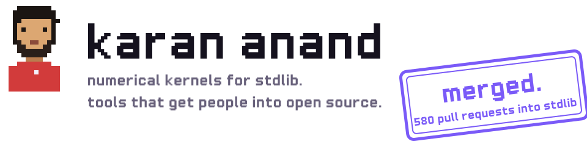
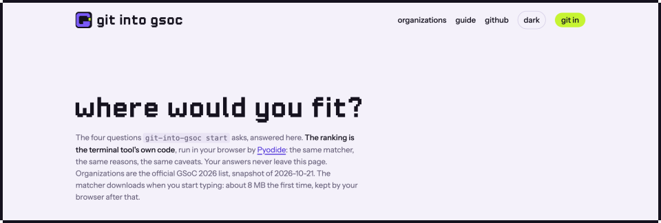
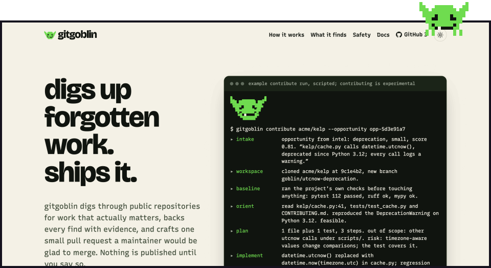

<picture>
  <source media="(max-width: 600px)" srcset="assets/hero-phone.svg">
  <source media="(prefers-color-scheme: dark)" srcset="assets/hero-dark.svg">
  <source media="(prefers-color-scheme: light)" srcset="assets/hero-light.svg">
  
</picture>

<a href="https://gitintogsoc.me/start/"><picture>
  <source media="(prefers-color-scheme: dark)" srcset="assets/plate-git-into-gsoc-dark.svg">
  <source media="(prefers-color-scheme: light)" srcset="assets/plate-git-into-gsoc-light.svg">
  
</picture></a>

**git into gsoc** finds the Google Summer of Code organizations that fit you and the repositories that actually merge newcomers' work, with the evidence for each. [Try it in the browser](https://gitintogsoc.me/start/) or [read the code](https://github.com/anandkaranubc/git-into-gsoc).

<a href="https://anandkaranubc.github.io/gitgoblin/"><picture>
  <source media="(prefers-color-scheme: dark)" srcset="assets/plate-gitgoblin-dark.svg">
  <source media="(prefers-color-scheme: light)" srcset="assets/plate-gitgoblin-light.svg">
  
</picture></a>

**gitgoblin** digs through public repositories for work that matters, backs every find with evidence, and crafts one small pull request a maintainer would be glad to merge. [Site](https://anandkaranubc.github.io/gitgoblin/) and [code](https://github.com/anandkaranubc/gitgoblin).

<a href="https://longhand-sand.vercel.app"><picture>
  <source media="(prefers-color-scheme: dark)" srcset="assets/plate-longhand-dark.svg">
  <source media="(prefers-color-scheme: light)" srcset="assets/plate-longhand-light.svg">
  
</picture></a>

**longhand** is first-year calculus practice: work it on paper, check it here, read the reasoning when you are stuck. [Practise](https://longhand-sand.vercel.app).

Under all of it: 580 pull requests merged into [stdlib](https://github.com/stdlib-js/stdlib) since December 2024, numerical kernels in C and JavaScript, and a Google Summer of Code 2025 project on special mathematical functions.

Five of the 580

- [#15676](https://github.com/stdlib-js/stdlib/pull/15676) Two parentheses. `1.0 / STDLIB_CONSTANT_FLOAT64_NAN` used to expand to `1.0 / 0.0/0.0`, which is `inf`.
- [#6511](https://github.com/stdlib-js/stdlib/pull/6511) `hypotf(±∞, NaN)` now returns +∞, as IEEE 754-2019 requires.
- [#6142](https://github.com/stdlib-js/stdlib/pull/6142) and [#7806](https://github.com/stdlib-js/stdlib/pull/7806) `rempio2f` and `kernel-sincosf`: reducing a float32 argument modulo π/2, and the sine and cosine kernels that rest on it.
- [#6965](https://github.com/stdlib-js/stdlib/pull/6965) `ellipj` in C: the Jacobi elliptic functions.
- [#15576](https://github.com/stdlib-js/stdlib/pull/15576) `truncated-normal/pdf` now normalizes before squaring, so extreme inputs no longer overflow or underflow.

