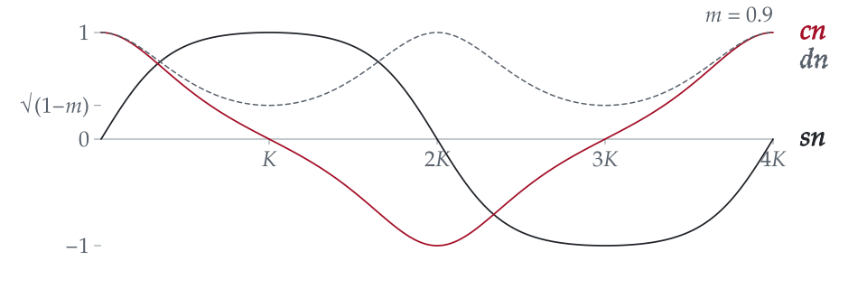

<picture>
  <source media="(prefers-color-scheme: dark)" srcset="assets/fig1-dark.svg">
  <source media="(prefers-color-scheme: light)" srcset="assets/fig1-light.svg">
  
</picture>

<b>Fig. 1</b>&nbsp; The Jacobi elliptic functions sn, cn and dn for <i>m</i> = 0.9, evaluated with the stdlib function I ported to C,[^ellipj] drawn by [a short script](scripts/fig1.mjs) in this repository.

I study computer science and mathematics at the University of British Columbia and write numerical software: the scalar kernels under a library's statistics and special-function APIs, in C and JavaScript.

### Numerical work

Since December 2024 I have merged 580 pull requests into [stdlib](https://github.com/stdlib-js/stdlib), the standard library for JavaScript and Node.js, and reviewed 260 by other people.[^stdlib] My Google Summer of Code 2025 project was *Implement base special mathematical functions in JavaScript and C*.[^gsoc] The work: single-precision trigonometry (`sinf`, `cosf`, `tanf` and the argument reduction under them), C ports of double-precision special functions, strided and ndarray BLAS extensions, and the reference fixtures that hold each to within a few ULPs.

Changes I would point a reviewer to:

- [#15676](https://github.com/stdlib-js/stdlib/pull/15676) Two parentheses. `1.0 / STDLIB_CONSTANT_FLOAT64_NAN` used to expand to `1.0 / 0.0/0.0`, which is `inf`.
- [#6511](https://github.com/stdlib-js/stdlib/pull/6511) `hypotf(±∞, NaN)` now returns +∞, as IEEE 754-2019 requires.
- [#6142](https://github.com/stdlib-js/stdlib/pull/6142) and [#7806](https://github.com/stdlib-js/stdlib/pull/7806) `rempio2f` and `kernel-sincosf`: reducing a float32 argument modulo π/2, and the sine and cosine kernels that rest on it.
- [#6965](https://github.com/stdlib-js/stdlib/pull/6965) `ellipj` in C, the implementation behind Fig. 1.
- [#15576](https://github.com/stdlib-js/stdlib/pull/15576) `truncated-normal/pdf` now normalizes before squaring, so extreme inputs no longer overflow or underflow.

### Tools for getting into open source

- **[git-into-gsoc](https://github.com/anandkaranubc/git-into-gsoc)** finds the Google Summer of Code organizations that fit you, the repositories that actually merge newcomers' pull requests, and the beginner issues nobody has claimed, with the evidence for each. A Python CLI, an MCP server and an agent skill; it also runs [in the browser](https://gitintogsoc.me/start/).
- **[gitgoblin](https://github.com/anandkaranubc/gitgoblin)** ranks public repositories for a goal (contribute, learn, adopt, revive) and lists work it can back with evidence: issues nobody is working on, CI about to break, docs that contradict the code, tests missing where the code changes most. TypeScript, on npm.

### Elsewhere

A fix in SymPy ([#27463](https://github.com/sympy/sympy/pull/27463): composite predicates mishandled `y = 1`), and type annotations across the unit tests of OpenStack's `python-ironicclient` during the spring 2026 [MLH Fellowship](https://fellowship.mlh.io).[^openstack]

[anandkarancompsci@gmail.com](mailto:anandkarancompsci@gmail.com) · [LinkedIn](https://linkedin.com/in/karananandubc)

[^ellipj]: [`@stdlib/math-base-special-ellipj`](https://github.com/stdlib-js/stdlib/tree/develop/lib/node_modules/%40stdlib/math/base/special/ellipj); the C implementation landed in [stdlib-js/stdlib#6965](https://github.com/stdlib-js/stdlib/pull/6965).
[^stdlib]: Counts as of 12 November 2026, from GitHub search: [merged pull requests](https://github.com/stdlib-js/stdlib/pulls?q=is%3Apr+is%3Amerged+author%3Aanandkaranubc) and [pull requests reviewed](https://github.com/stdlib-js/stdlib/pulls?q=is%3Apr+reviewed-by%3Aanandkaranubc). Sixth by commit count on the project's [contributors graph](https://github.com/stdlib-js/stdlib/graphs/contributors), fifth among people.
[^gsoc]: [GSoC 2025 projects announced](https://dev.to/stdlib/gsoc-2025-projects-announced-53al), the stdlib blog, May 2025.
[^openstack]: [Commits in openstack/python-ironicclient](https://github.com/openstack/python-ironicclient/commits?author=anandkaranubc), reviewed through OpenDev's Gerrit.
