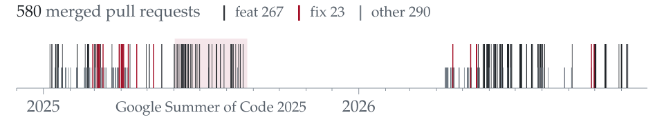
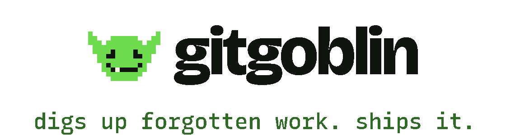

<picture>
  <source media="(max-width: 600px)" srcset="assets/fig-merges-phone.svg">
  <source media="(prefers-color-scheme: dark)" srcset="assets/fig-merges-dark.svg">
  <source media="(prefers-color-scheme: light)" srcset="assets/fig-merges-light.svg">
  
</picture>

<b>Fig. 1</b>&nbsp; Every pull request of mine merged into [stdlib](https://github.com/stdlib-js/stdlib), the standard library for JavaScript and Node.js, one hairline per merge: numerical kernels in C and JavaScript under its special-function, statistics and BLAS APIs, with 260 reviews of other people's work alongside.[^stdlib] The band is my [Google Summer of Code 2025](https://dev.to/stdlib/gsoc-2025-projects-announced-53al) project, <i>Implement base special mathematical functions in JavaScript and C</i>.

Five of the 580

- [#15676](https://github.com/stdlib-js/stdlib/pull/15676) Two parentheses. `1.0 / STDLIB_CONSTANT_FLOAT64_NAN` used to expand to `1.0 / 0.0/0.0`, which is `inf`.
- [#6511](https://github.com/stdlib-js/stdlib/pull/6511) `hypotf(±∞, NaN)` now returns +∞, as IEEE 754-2019 requires.
- [#6142](https://github.com/stdlib-js/stdlib/pull/6142) and [#7806](https://github.com/stdlib-js/stdlib/pull/7806) `rempio2f` and `kernel-sincosf`: reducing a float32 argument modulo π/2, and the sine and cosine kernels that rest on it.
- [#6965](https://github.com/stdlib-js/stdlib/pull/6965) `ellipj` in C, the function behind Fig. 2.
- [#15576](https://github.com/stdlib-js/stdlib/pull/15576) `truncated-normal/pdf` now normalizes before squaring, so extreme inputs no longer overflow or underflow.

<picture>
  <source media="(max-width: 600px)" srcset="assets/fig-ellipj-phone.svg">
  <source media="(prefers-color-scheme: dark)" srcset="assets/fig-ellipj-dark.svg">
  <source media="(prefers-color-scheme: light)" srcset="assets/fig-ellipj-light.svg">
  
</picture>

<b>Fig. 2</b>&nbsp; sn, cn and dn as <i>m</i> drifts between 0 and 1, computed by the stdlib function I ported to C.[^ellipj]

<a href="https://github.com/anandkaranubc/git-into-gsoc"><picture>
  <source media="(prefers-color-scheme: dark)" srcset="assets/marks/git-into-gsoc-dark.svg">
  
</picture></a>

Which Google Summer of Code organizations fit you, and which repositories will actually merge your work, with the evidence. [gitintogsoc.me](https://gitintogsoc.me/start/)

<a href="https://github.com/anandkaranubc/gitgoblin"><picture>
  <source media="(prefers-color-scheme: dark)" srcset="assets/marks/gitgoblin-dark.svg">
  
</picture></a>

Finds the work a repository needs, with evidence, and helps you ship it to the project's own standard. [Site](https://anandkaranubc.github.io/gitgoblin/)

Elsewhere: [longhand](https://longhand-sand.vercel.app), practice for first-year calculus with the reasoning written out; type annotations across OpenStack's [python-ironicclient](https://github.com/openstack/python-ironicclient/commits?author=anandkaranubc) tests, MLH Fellowship, spring 2026; [one fix](https://github.com/sympy/sympy/pull/27463) in SymPy.

[^stdlib]: Counts as of 12 November 2026, from GitHub search: [merged pull requests](https://github.com/stdlib-js/stdlib/pulls?q=is%3Apr+is%3Amerged+author%3Aanandkaranubc) and [pull requests reviewed](https://github.com/stdlib-js/stdlib/pulls?q=is%3Apr+reviewed-by%3Aanandkaranubc). Sixth by commit count on the project's [contributors graph](https://github.com/stdlib-js/stdlib/graphs/contributors), fifth among people. Drawn by [scripts/fig-merges.mjs](scripts/fig-merges.mjs) from [data/stdlib-merged.json](data/stdlib-merged.json).
[^ellipj]: [`@stdlib/math-base-special-ellipj`](https://github.com/stdlib-js/stdlib/tree/develop/lib/node_modules/%40stdlib/math/base/special/ellipj), C implementation in [stdlib-js/stdlib#6965](https://github.com/stdlib-js/stdlib/pull/6965). Drawn by [scripts/fig-ellipj.mjs](scripts/fig-ellipj.mjs); it moves only if your system allows motion.
