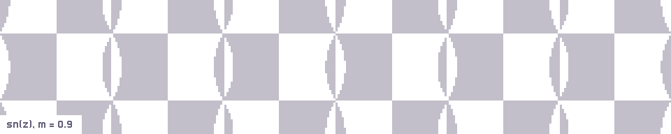
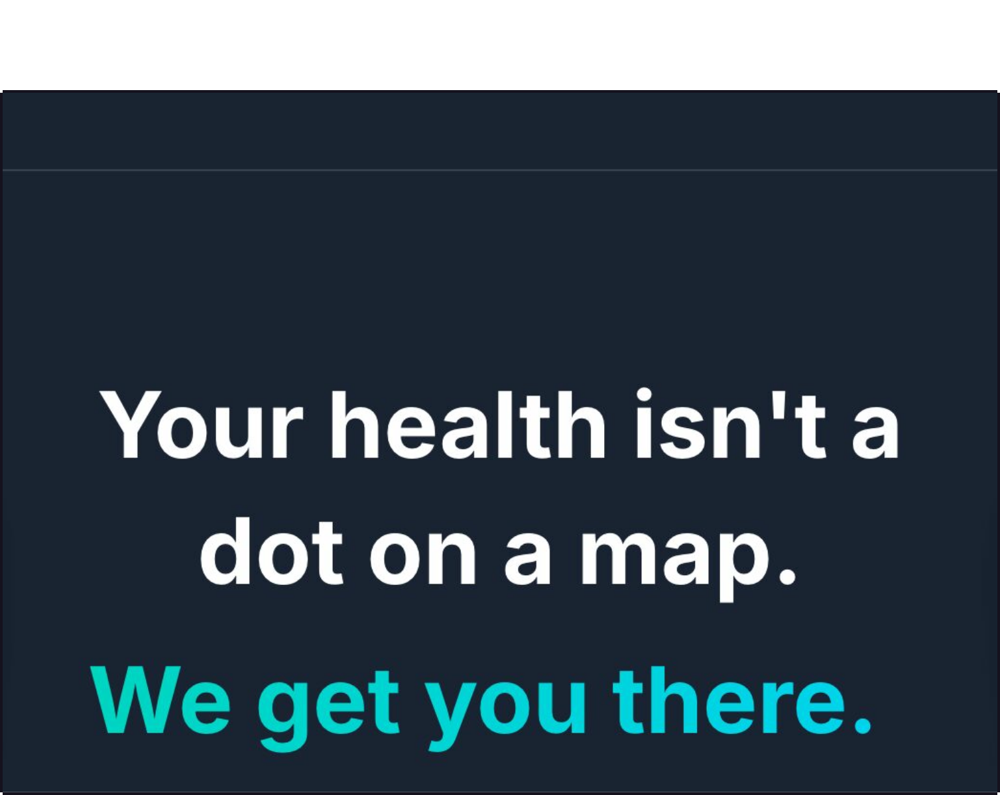

<picture>
  <source media="(max-width: 600px) and (prefers-color-scheme: dark)" srcset="assets/hero-phone-dark.svg">
  <source media="(max-width: 600px)" srcset="assets/hero-phone-light.svg">
  <source media="(prefers-color-scheme: dark)" srcset="assets/hero-dark.svg">
  <source media="(prefers-color-scheme: light)" srcset="assets/hero-light.svg">
  
</picture>

<a href="https://gitintogsoc.me/start/"><picture><source media="(prefers-color-scheme: dark)" srcset="assets/plate-git-into-gsoc-dark.svg"><source media="(prefers-color-scheme: light)" srcset="assets/plate-git-into-gsoc-light.svg"></picture></a>

**git into gsoc** finds the Google Summer of Code organizations that fit you, with the evidence. [Site](https://gitintogsoc.me/start/), [code](https://github.com/anandkaranubc/git-into-gsoc).

<a href="https://anandkaranubc.github.io/gitgoblin/"><picture><source media="(prefers-color-scheme: dark)" srcset="assets/plate-gitgoblin-dark.svg"><source media="(prefers-color-scheme: light)" srcset="assets/plate-gitgoblin-light.svg"></picture></a> <a href="https://longhand-sand.vercel.app"><picture><source media="(prefers-color-scheme: dark)" srcset="assets/plate-longhand-dark.svg"><source media="(prefers-color-scheme: light)" srcset="assets/plate-longhand-light.svg"></picture></a>

**gitgoblin** finds the work a repository needs and ships it with evidence. [Site](https://anandkaranubc.github.io/gitgoblin/), [code](https://github.com/anandkaranubc/gitgoblin). **longhand** is first-year calculus, in course order, worked on paper. [Site](https://longhand-sand.vercel.app).

<a href="https://github.com/stdlib-js/stdlib/pulls?q=is%3Apr+is%3Amerged+author%3Aanandkaranubc"><picture><source media="(prefers-color-scheme: dark)" srcset="assets/frieze-dark.svg"><source media="(prefers-color-scheme: light)" srcset="assets/frieze-light.svg"></picture></a>

sn(z) on the complex plane, from the function I ported to C for [stdlib](https://github.com/stdlib-js/stdlib), where my pull requests have been merging since December 2024. The one I would show first is [#15676](https://github.com/stdlib-js/stdlib/pull/15676): two parentheses, because `1.0 / NAN` expanded to `1.0 / 0.0/0.0`, which is `inf`.

<a href="https://e-rly.vercel.app"><picture><source media="(prefers-color-scheme: dark)" srcset="assets/plate-erly-dark.svg"><source media="(prefers-color-scheme: light)" srcset="assets/plate-erly-light.svg"></picture></a> <a href="https://whim.schangchang-li.workers.dev"><picture><source media="(prefers-color-scheme: dark)" srcset="assets/plate-whim-dark.svg"><source media="(prefers-color-scheme: light)" srcset="assets/plate-whim-light.svg"></picture></a>

Built with friends over a weekend: **ERly** at HackCanada 2026 triages symptoms and routes you to care with live wait times ([site](https://e-rly.vercel.app), [code](https://github.com/bhumi6633/ERly)); **Whim** at Hack the North 2026 is an agent that lives in the group chat ([site](https://whim.schangchang-li.workers.dev), [code](https://github.com/chang-07/htn-26)).
